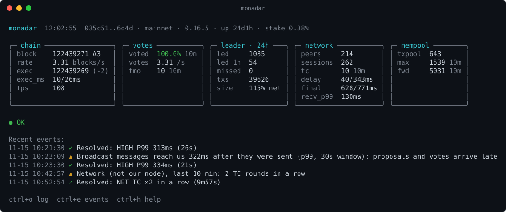

# monadar

Monitoring for a [Monad](https://monad.xyz) validator. One static binary runs as a daemon next
to the node: it reads the node's JSON-RPC (`eth_blockNumber`), receives its OTLP metrics, follows
the monad-bft and monad-execution journals, and sends Telegram alerts. A viewer attaches to the
daemon and shows a live dashboard.



## What it watches

- Block production, execution lag and execution time, peers, broadcast p99, RPC
- Our votes and leader rounds: proposed, missed, unseen, late, block size against the network
- Network health: share of rounds ended by timeout certificates
- Telegram alerts with a delivery queue that survives outages and restarts, plus `/status` and
  `/events` on demand
- A dead man's switch (`heartbeat_url`) for when the whole host goes down

## Requirements

- x86_64 Linux next to a Monad node (macOS works for development)
- RPC at `http://localhost:8080`
- Metrics: the node's `--otel-endpoint` pointing at `127.0.0.1:4317`, where monadar receives
  them (no OpenTelemetry Collector needed), or a Prometheus endpoint at
  `http://localhost:8889/metrics`
- Journal access (root or the `systemd-journal` group) for execution latency and leader rounds;
  rounds come from `monad-ledger-tail` (enable it: `systemctl enable --now monad-ledger-tail`)
  or from monad-bft logging at DEBUG

## Install

Download a release binary, check it, and install it with its config next to it:

```sh
V=v1.1.1
curl -fLO https://github.com/coinblitz-pro/monadar/releases/download/$V/monadar-$V-x86_64-linux-musl
curl -fLO https://github.com/coinblitz-pro/monadar/releases/download/$V/SHA256SUMS
sha256sum -c SHA256SUMS
gh attestation verify monadar-$V-x86_64-linux-musl -R coinblitz-pro/monadar  # optional, see docs/building.md

sudo install -D -m 755 monadar-$V-x86_64-linux-musl /opt/monadar/monadar
sudo /opt/monadar/monadar --init                  # /opt/monadar/monadar.config.json
sudo /opt/monadar/monadar install --log /opt/monadar/logs/monadar.log
sudo systemctl enable --now monadar
/opt/monadar/monadar                              # attach the viewer
```

To update, replace the binary and run `sudo systemctl restart monadar`; the config, logs and
the Telegram queue stay. `install` refuses a binary in a temporary directory, because the unit
would point at a file that disappears.

## Usage

```sh
monadar                  # attach the viewer to the running daemon
monadar status           # is the daemon running?
monadar telegram-test    # send sample alerts to the configured chat
monadar --help
```

## Documentation

- [How it works](docs/architecture.md): daemon and viewer, update rate, data sources
- [Configuration](docs/configuration.md): commands, service setup, flags, config file, logs
- [Alerts and Telegram](docs/alerts.md): alert rules, delivery, bot commands
- [Leader rounds](docs/rounds.md): how rounds are classified, round alerts, block size
- [Dashboard](docs/dashboard.md): fields and keys
- [Metrics](docs/metrics.md): node metrics and journal lines, and which ones monadar uses
- [Building and releases](docs/building.md): build, tests, reproducible builds, verification
